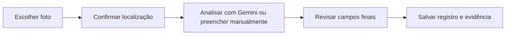

# Fluxo de coleta mobile

O cadastro foi organizado em quatro etapas, com avanço e retorno, para uso no celular.

## 1. Foto

A pessoa tira uma foto ou escolhe um arquivo da galeria. O aplicativo aceita JPEG, inclusive extensões `.jpg`, `.jpeg` e `.jfif`, PNG e WebP, dentro do limite configurado. Depois da seleção, a prévia substitui o seletor, com opção de trocar a imagem.

Fotos devem evitar pessoas, documentos e dados pessoais desnecessários. A imagem serve de evidência da observação; não comprova disponibilidade ou funcionamento atual dos recursos.

## 2. Localização

É possível usar geolocalização do dispositivo, marcar o mapa ou informar coordenadas. A posição precisa ser confirmada para continuar. O registro distingue GPS original, ponto corrigido, origem da localização, horário e acurácia quando disponível.

Em celulares, a geolocalização exige contexto seguro, normalmente HTTPS, e permissão do navegador. GPS não identifica andar. O aplicativo de coleta consulta apenas um catálogo local de polígonos para sugerir prédio; o KML de pontos do piloto não substitui esse catálogo.

## 3. Análise opcional

A análise da foto com Gemini é uma ação explícita. Também é possível preencher a descrição manualmente, sem consumir uma chamada ao provedor. Há um provedor simulado para desenvolvimento, identificado como simulação.

Não há envio de screenshot do mapa à IA nesta versão. Sugestões do modelo são armazenadas separadamente da descrição final.

## 4. Revisão e salvamento

A pessoa confere nome, categoria, descrição, prédio, andar e observações. Andar é escolhido em uma lista; não é inferido pelo GPS. A revisão humana é registrada e o local é salvo.

O marcador de revisão do aplicativo confirma os campos finais, sem certificar individualmente todos os objetos que a IA sugeriu. A curadoria do RAG precisa respeitar esse limite.

## Armazenamento e execução

O backend é FastAPI, com frontend separado. O projeto admite SQLite local e armazenamento externo Supabase. Na configuração de deploy Render/Supabase, os arquivos de imagem ficam no Storage privado e os metadados no PostgreSQL, sem gravar a imagem como BLOB no banco.

A página de documentação é estática e não acessa esse banco nem recebe fotos. O deploy e as credenciais do aplicativo de coleta são independentes do GitHub Pages.
