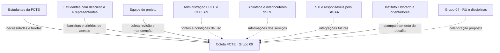

# Mapa de stakeholders

Os usuários principais são estudantes que consultam locais e serviços e integrantes da equipe que coletam e revisam dados. Os demais grupos abaixo são **interlocutores propostos**; não se presume parceria formal ou participação já confirmada.

| Grupo | Interesse e contribuição | Relação prevista |
|---|---|---|
| Estudantes da FCTE | Relatar dificuldades, priorizar funções e avaliar uso no celular | Participação voluntária na validação |
| Estudantes com deficiência e representantes de acessibilidade | Identificar barreiras de ambientes, trajetos e interface | Participação a buscar, sem presumir representatividade |
| Equipe do projeto | Coletar, revisar, desenvolver, verificar e manter os dados | Execução do projeto |
| Administração da FCTE e CEPLAN | Orientar sobre plantas, locais, atualização e uso de dados | Interlocução proposta |
| Biblioteca e RU | Esclarecer fontes e informações dos serviços | Biblioteca no recorte local; conteúdo alimentar articulado com Grupo 04 |
| STI e responsáveis pelo SIGAA | Orientar acesso a informações acadêmicas e futuras integrações | Interlocução futura; sem acesso a contas de estudantes |
| Instituto Eldorado e orientadores | Acompanhar o desafio e avaliar entregáveis e decisões | Acompanhamento acadêmico |
| Grupo 04 | Manter sua frente de RU/disciplinas e discutir integração | Sistemas e entregas independentes |

## Cuidados na participação

Registrar o perfil e a quantidade de participantes, buscar diversidade de necessidades e não apresentar interlocutores propostos como parceiros. A contribuição para uma entrevista não autoriza uso de GPS, exposição de dados pessoais ou publicação de imagens.
