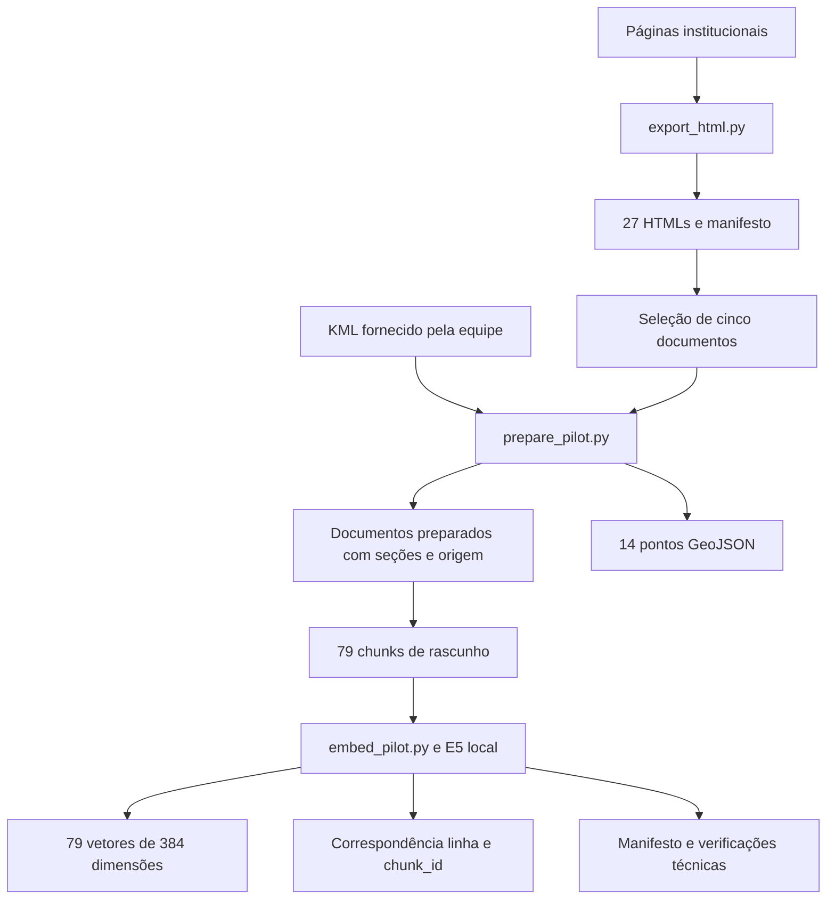
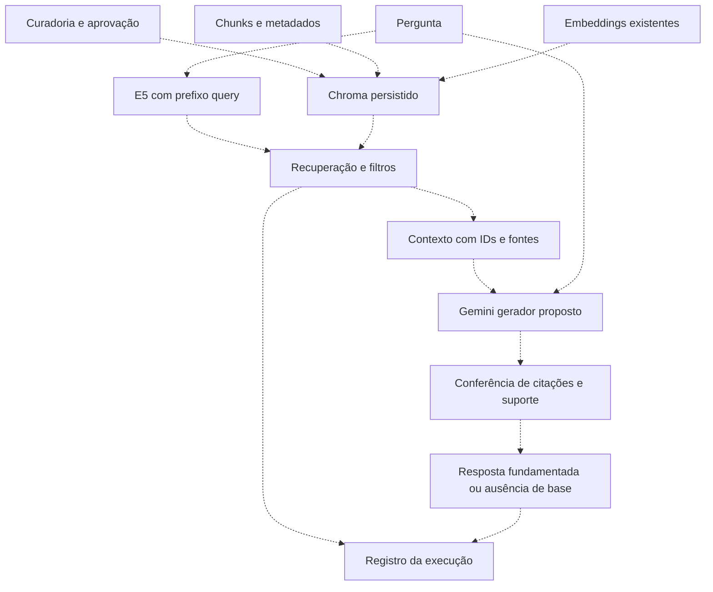
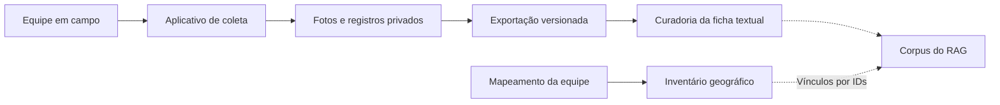

# Diagrama de arquitetura

## Componentes já executados

Essa parte foi executada. Não contém geração de respostas, busca vetorial ou chamadas ao Gemini. O corpus fica local durante a codificação; o Hub foi usado para obter os arquivos públicos do modelo.

## Arquitetura RAG proposta

As setas tracejadas representam etapas ainda pendentes. O gerador receberá evidências recuperadas em cada pergunta; isso não altera seus pesos nem torna o modelo um cadastro permanente do campus.

## Relação com o aplicativo de coleta

O pipeline RAG não escreve no banco de produção da coleta nesta etapa. Fotos não são reenviadas a um modelo em cada consulta textual. A integração com o Grupo 04 aparece como [proposta de colaboração](../visao/escopo.md), independente da implementação interna acima.
