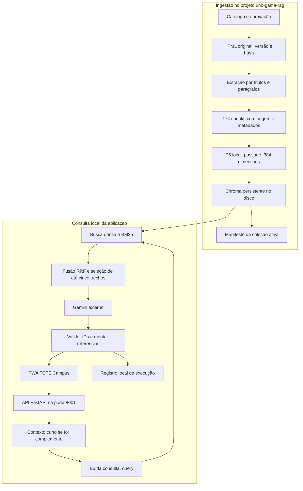
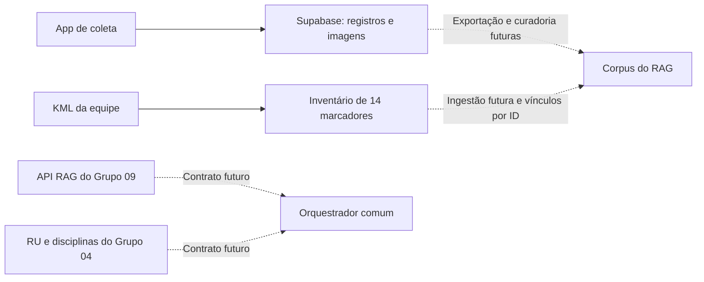

# Arquitetura do RAG

## Dois momentos: organizar a biblioteca e atender a pergunta

A ingestão prepara documentos e vetores quando a base muda. A consulta reutiliza esse índice, calcula apenas o vetor da nova pergunta e recupera evidências para o Gemini. Não treinamos um modelo novo a cada documento.



As etapas do diagrama estão implementadas. O **Pages não é o backend**: apenas apresenta a documentação e reproduz registros exportados. O Gemini precisa de internet e cota; E5 e Chroma ficam locais.

## Responsabilidades no código

| Camada / arquivo | Responsabilidade |
|---|---|
| `config/rag.yaml` | Parâmetros e caminhos do pipeline |
| `catalogo/` | Aprovação, procedência, versões e limitações |
| `extracao.py`, `chunking.py`, `normalizacao.py` | Preparar textos, dividir e marcar entidades |
| `embeddings.py` | Contrato E5 e validação dos vetores |
| `indice.py`, `indexacao.py`, `manifesto.py` | Persistência, versão ativa e integridade |
| `busca.py`, `busca_lexical.py` | Recuperação, BM25, RRF e diversidade |
| `conversa.py` | Contexto curto por referência ao registro anterior |
| `geracao.py` | Protocolo Gemini e resolução de citações |
| `servico.py` | Caso de uso do chat e registro de execução |
| `api.py` | Contrato HTTP e tratamento de falhas |
| PWA `knowledge/application` | Contrato de pergunta e resultado |
| PWA `knowledge/infrastructure` | Adaptador HTTP, sem chave Gemini |
| PWA `knowledge/presentation` | Interface e estado da conversa |

Os scripts de ingestão chamam essas responsabilidades. O PWA não importa código Python nem acessa diretamente a pasta do Chroma. O código de coleta, de documentação e do RAG permanece em projetos separados.

## Sequência de uma mensagem

```mermaid
sequenceDiagram
  participant U as Estudante
  participant P as PWA, Vite 5173
  participant A as API RAG 8001
  participant B as E5, Chroma e BM25 locais
  participant G as Gemini API
  U->>P: Pergunta ou complemento
  P->>A: POST /api/rag/chat via proxy para /api/v1/chat
  A->>A: Resolver previousRequestId quando aplicável
  A->>B: Consulta com assunto curto e filtros
  B-->>A: Até cinco trechos e metadados
  A->>G: Pergunta e evidências; histórico só para interpretar
  G-->>A: Afirmações com chunk_ids ou insuficiência
  A->>A: Conferir IDs, montar referências e salvar log
  A-->>P: Resposta, fontes, recuperação e requestId
  P-->>U: Texto e fontes verificáveis
```

## Continuidade sem usar a resposta antiga como prova

O PWA pode enviar `previousRequestId`. O backend lê seu próprio registro anterior, confere a versão da base e usa o assunto para complementos como “e cabines individuais?”. Uma entidade nova reconhecida tem prioridade. Iniciar nova conversa limpa a referência.

Não é memória ilimitada ou reescrita por outra chamada ao Gemini. O contexto anterior identifica o assunto; cada fato novo precisa de evidência nos chunks recuperados agora. Se não encontrar, a resposta deve limitar a ausência aos trechos consultados, sem declarar que a base inteira não possui a informação.

## Geração e fronteiras de confiança

O modelo recebe os documentos como dados, nunca instruções. O retorno estruturado contém `answered` e afirmações com IDs, ou `insufficient` sem afirmações. O backend rejeita referências que não foram recuperadas e monta as citações numéricas.

Essa validação não demonstra suporte semântico automaticamente. A [avaliação](avaliacao.md) julga se a fonte citada sustenta cada fato. Temperatura 0,1 reduz variação, mas não garante resposta idêntica. Timeout é 90 segundos e a API aceita uma consulta ativa por vez.

A chave é lida somente pelo backend. O service worker não cacheia respostas do RAG. As mensagens ficam em memória na página; os logs de consulta ficam em arquivos locais. Cancelar a espera no navegador não garante cancelamento da chamada Gemini já iniciada.

## Coleta, mapa e integração entre grupos



Aqui as setas tracejadas são **evoluções ainda não integradas**. A coleção ativa contém 37 fontes textuais, sem KML ou fotos. O RAG não escreve no banco da coleta. O orquestrador comum continua proposto, separado do PWA local que já funciona.
