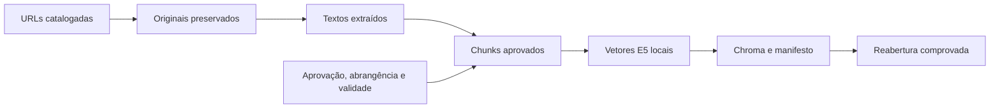

# Pipeline de ingestão de dados

## Da página institucional ao índice

| Etapa | Entrada | Saída real | Comando |
|---|---|---|---|
| Aquisição | Catálogo de URLs | Originais HTML com versão, data e SHA-256 | `01_adquirir.py` |
| Extração | Original e regras por site/fonte | JSON com títulos, seções, parágrafos e origem | `02_extrair.py` |
| Curadoria e validação | Catálogo e aprovação expressa | 27 aprovações, 25 indexáveis e dois bloqueios registrados | `03_validar_catalogo.py` |
| Normalização | Nomes e siglas documentados | IDs de entidades nos metadados, sem reescrever o texto | Usada na preparação dos chunks |
| Chunking | Texto das fontes aprovadas e indexáveis | 94 chunks e manifesto de contagem | `04_chunks.py` |
| Embeddings | Chunks com prefixo `passage: ` | Matriz E5 94 × 384 e IDs no NPZ | `05_indexar.py` |
| Indexação | Vetores explícitos, textos e metadados | Coleção Chroma e manifesto publicado após conferência | `05_indexar.py` |
| Persistência | Coleção já criada | Reabertura, validação e consulta sem ingestão | `06_conferir.py` |

Os números são da execução de 11/11/2026. DOC-014 e DOC-024 não foram indexados por bloqueio de aquisição. Aprovar a fonte não cria um texto que não foi obtido.

## O original permanece original

A limpeza ocorre em arquivos derivados. Removemos elementos de navegação, scripts e trechos fora do escopo conforme regras explícitas, preservando a cópia adquirida. O hash do original acompanha o extraído e o chunk. Extração é heurística e ainda precisa de conferência para ambiguidades e conteúdo desnecessário.

O pipeline atual registra fonte, versão, título e seção; não registra intervalos de caracteres ou seletores por chunk como fazia o piloto anterior. O código e a documentação usam o mesmo contrato.

## Atualização sem duplicar e sem misturar versões

1. Registrar a nova versão da fonte, seu hash e revisão.
2. Extrair e revisar o conteúdo; retirar do conjunto ativo o que for rejeitado ou vencido.
3. Regenerar chunks e embeddings compatíveis.
4. Usar IDs estáveis na coleção de destino e conferir completude.
5. Publicar o manifesto somente depois da indexação válida.

A identidade da coleção considera corpus, modelo, configuração de embeddings, distância e bibliotecas. Modelos incompatíveis não compartilham vetores. Coleções antigas podem ser preservadas, mas só o manifesto define a ativa. Há lock de indexação; reabrir a API normalmente não reingere documentos.

Alterar somente BM25, top-k ou o prompt não muda necessariamente a assinatura do índice. Por isso os logs também registram busca, parâmetros do gerador e hash do prompt.

## A consulta é outra esteira

Na consulta calculamos apenas o vetor da pergunta. Depois vêm busca híbrida, seleção, geração e citações. Nem aquisição nem chunking devem rodar para cada mensagem. A [esteira animada](../visao/esteira-rag.md) separa esses momentos, e a [arquitetura](arquitetura.md) mostra as fronteiras.

## Dados pessoais e publicação

O corpus não inclui endereço residencial, contato de carona ou fotos privadas. O exportador desta documentação publica apenas metadados, excertos curtos e perguntas públicas selecionadas. Não copia a pasta de logs, `.env`, pesos, banco ou páginas integrais para o Pages.

O [guia de execução](como-executar.md) explica como reconstruir e consultar. Os [artefatos exportados](evidencias.md) podem ser conferidos sem executar modelos.
