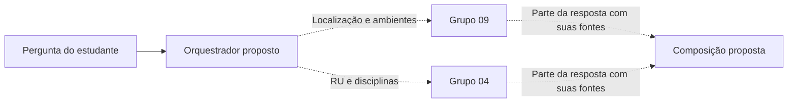

# Escopo e integração com o Grupo 04

A documentação do [residencia-grupo-4](https://github.com/maykonjuso/residencia-grupo-4) apresenta duas frentes independentes e uma possível integração. Esta página registra nosso recorte, sem apresentar a integração proposta como funcionalidade já implementada.

## Responsabilidades

| Tema | Grupo 09 · Coleta FCTE | Grupo 04 · RUmo |
|---|---|---|
| Conhecimento principal | Prédios, ambientes, acessos e serviços do campus | Restaurante Universitário e fluxo de disciplinas |
| Fontes | Páginas institucionais, mapeamento da equipe e coletas revisadas | Fontes e documentos mantidos pelo próprio grupo |
| Processamento | Pipeline e índice próprios | Pipeline e índice próprios |
| Entrega acadêmica | Evidências completas da nossa frente | Evidências completas da frente do Grupo 04 |
| Identidade visual | Azul/verde, tipografia e componentes compartilhados | Referência visual adotada neste site |

RU, cardápios e regras de disciplinas não compõem nosso piloto RAG. Um marcador de RU pode permanecer no arquivo geográfico original como referência, com sua exclusão do recorte textual explicitada.

## Integração futura

O objetivo é manter as evidências de cada módulo identificadas. A composição não deve converter ausência de dados de um sistema em uma resposta inventada pelo outro.

O contrato `POST /perguntar` mencionado pelo Grupo 04 é uma proposta de interface comum. Nosso protótipo atual de coleta tem suas próprias rotas, como `/api/analyze`; isso não representa uma API RAG já disponível.

## Transporte e caronas

Estas capacidades foram discutidas como evolução, sem implementação neste piloto. Seus critérios estão centralizados em [RF16 e RF17 · Requisitos da Entrega 1](../entrega-1/requisitos.md).

O transporte usará horários programados; posição atual de ônibus ficou fora do recorte. Partida no terminal não é passagem em uma parada intermediária. Estimar chegada depende de tempos de percurso identificados. Caronas dependerão de adesão voluntária e interesse mútuo antes de compartilhar contato.

As páginas de transporte adquiridas hoje são orientações sobre consulta, não uma base estruturada de viagens. A integração dessas tabelas será separada da busca textual por embeddings.
